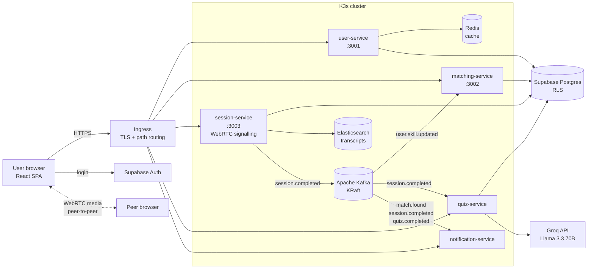
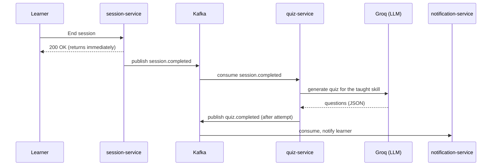
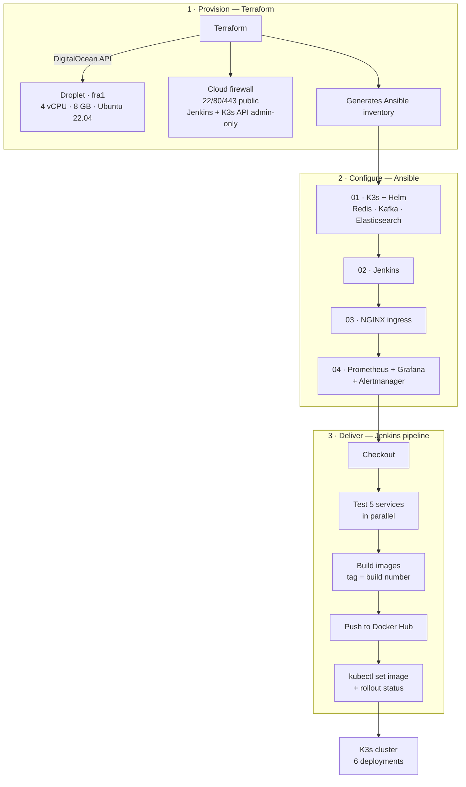

<div align="center">


<a href="#"></a>

<p>
  <a href="http://skillbridge-sen3244.duckdns.org"></a>
  <a href="#-architecture"></a>
  <a href="#%EF%B8%8F-cloud-infrastructure"></a>
  <a href="docs/Architecture.md"></a>
</p>


</div>

<br/>

> **TL;DR:** Users list skills they can teach and want to learn. Skill-Bridge matches complementary peers, connects them in a peer-to-peer browser video call, then generates an AI quiz to prove the learning happened. It runs as 5 event-driven microservices on Kubernetes, on infrastructure built entirely from Terraform and Ansible.

---

<details>
<summary><b>📑 Table of contents</b></summary>

1. [🎯 Problem](#-problem)
2. [💡 Solution](#-solution)
3. [✨ Features](#-features)
4. [🏗 Architecture](#-architecture)
5. [☁️ Cloud infrastructure](#️-cloud-infrastructure)
6. [🧰 Tech stack](#-tech-stack)
7. [⚖️ Design decisions](#️-design-decisions-and-trade-offs)
8. [🚀 Getting started](#-getting-started)
9. [🧪 Testing](#-testing)
10. [📁 Project structure](#-project-structure)
11. [🗺 Roadmap](#-known-limitations-and-roadmap)
12. [👥 Team](#-team)

</details>

---

## 🎯 Problem

Learning from a peer is one of the fastest ways to pick up a skill, but it is hard to organise:

- **Finding a partner is luck.** There is no reliable way to find someone who can teach what you want to learn *and* wants to learn something you can teach.
- **Meeting is friction.** Most video tools need an install, an account or a paid plan before two strangers can talk.
- **Nothing proves learning happened.** A conversation ends and there is no record or check that the learner actually understood anything.

## 💡 Solution

Skill-Bridge turns informal skill swaps into a structured loop:

```
List skills (teach / learn)  →  Get matched  →  Meet live in the browser  →  Take an AI-generated quiz  →  Earn XP and badges
```

Users list the skills they can teach and the skills they want to learn. A scoring algorithm pairs complementary users. Matched peers meet in a browser video call with chat, with nothing to install. When the session ends, an event triggers an LLM to generate a quiz on the skill that was taught. Passing it awards experience points and badges, which turns the session into evidence of learning.

## ✨ Features

| Feature | What it does | How it works |
| --- | --- | --- |
| **Skill profiles** | Users list skills to teach or learn, each with a proficiency level (1–5) | `user-service` stores profiles, the skill catalogue and user skills in Supabase Postgres. Hot reads are cached in Redis using cache-aside with a 300-second TTL. |
| **Smart matching** | Pairs learners with suitable teachers and ranks them | `matching-service` scores each pair out of 100: 60 points for a confirmed skill match, up to 20 for the proficiency gap (a gap of 1–2 levels scores highest) and up to 20 for timezone proximity. It re-runs automatically when a `user.skill.updated` event arrives. |
| **Live video sessions** | Two matched users meet in the browser with video and text chat | WebRTC media flows **peer-to-peer** between browsers, using STUN/TURN for NAT traversal. `session-service` only does signalling, over a WebSocket on `/ws/signal`, so video traffic never touches the servers. Chat messages are saved. |
| **AI-generated quizzes** | After a session, the learner gets a quiz on what was taught | When a session ends, `session-service` publishes `session.completed` to Kafka. `quiz-service` consumes it and calls Llama 3.3 70B through the Groq API to generate questions in the background, so ending a session never waits for the LLM. |
| **XP and badges** | Rewards learners who pass quizzes | `quiz-service` follows the **CQRS** pattern: `GenerateQuizCommand` and `SubmitAttemptCommand` handle writes, while `GetQuizQuery` and `GetResultQuery` handle reads. A badge awarder grants achievements when an attempt is scored. |
| **Transcript search** | Users search past session transcripts | Session transcripts are indexed in **Elasticsearch** (`session_transcripts` index) for full-text search. |
| **Notifications** | Alerts for new matches, completed sessions and quiz results | `notification-service` consumes `match.found`, `session.completed` and `quiz.completed`. Calls to external providers go through a **circuit breaker** (CLOSED → OPEN → HALF_OPEN) so a failing provider can't cause cascading failures. |
| **Onboarding and auth** | Guided first-run setup and secure sign-in | Supabase Auth issues the tokens. Each service checks them in its own auth middleware, and an onboarding gate in the SPA routes new users through a setup wizard. |

## 🏗 Architecture

Skill-Bridge is made of **five independent Node.js microservices** behind an ingress, with a React single-page app in front. Services never call each other's internals. They communicate **asynchronously through Apache Kafka events** and share a managed Postgres database for data that has to stay consistent.

### System overview



### Event flow: from session to quiz



### Kafka topics

| Topic | Producer | Consumers |
| --- | --- | --- |
| `session.completed` | session-service | quiz-service, notification-service |
| `user.skill.updated` | skill updates | matching-service |
| `match.found` | matching | notification-service |
| `quiz.completed` | quiz flow | notification-service |

## ☁️ Cloud infrastructure

The whole platform runs on one cloud VM that is **provisioned, configured and deployed entirely from code**. Nothing on the server is set up by hand.



### 1. Provisioning: Terraform

[`infrastructure/terraform/`](infrastructure/terraform)

- Creates a **DigitalOcean droplet** in Frankfurt (`fra1`, the closest region to Cameroon), sized `s-4vcpu-8gb`, and bootstraps it with a setup script through `user_data`.
- Defines a **cloud firewall**. SSH, HTTP and HTTPS are public. **Jenkins (8080) and the Kubernetes API (6443) only accept traffic from `admin_cidrs`**, so the control plane is never exposed to the internet.
- **Generates the Ansible inventory** from the droplet's IP address, so provisioning and configuration hand over with no manual copy-paste.
- Secrets such as the DigitalOcean token are marked `sensitive` and supplied through `terraform.tfvars`, which is not committed.

### 2. Configuration: Ansible

[`infrastructure/ansible/playbooks/`](infrastructure/ansible/playbooks)

| Playbook | Installs |
| --- | --- |
| `01_install_k3s.yml` | K3s (lightweight Kubernetes) and Helm. Uses Bitnami charts to install **Redis** (password-protected), **Kafka** in KRaft mode (no ZooKeeper) and **Elasticsearch** with memory limits. |
| `02_install_jenkins.yml` | Jenkins on Java 17 from the signed upstream repository |
| `03_configure_nginx.yml` | The NGINX ingress controller, installed with Helm |
| `04_deploy_monitoring.yml` | **kube-prometheus-stack**: Prometheus, Grafana and Alertmanager |

The playbooks are **idempotent**: running one again skips releases that already exist instead of failing. They **refuse to run without required secrets**, asserting that `REDIS_PASSWORD` and `GRAFANA_ADMIN_PASSWORD` are set, and keep secret values out of logs with `no_log`.

### 3. Orchestration: Kubernetes (K3s)

[`k8s/`](k8s)

- **6 deployments** (5 services plus the frontend), each running **2 replicas** for availability.
- **Zero-downtime rolling updates**: `maxSurge: 1`, `maxUnavailable: 0`.
- **Liveness and readiness probes** on `/health`, so Kubernetes restarts unhealthy pods and only routes traffic to pods that are ready.
- **Resource requests and limits** on every container (for example 128–256 Mi memory and 100–250 m CPU), so one service can't starve the others.
- **Configuration through Kubernetes Secrets** (`secretKeyRef`), not hard-coded into images.
- Services use internal `ClusterIP` services, and only the ingress is exposed.

### 4. Continuous delivery: Jenkins

[`Jenkinsfile`](Jenkinsfile)

1. **Test.** All five services install with `npm ci` and run Jest with coverage, **in parallel**.
2. **Build.** Each service and the frontend are built as Docker images tagged with both the **build number** and `latest`, so every deployment can be traced and rolled back.
3. **Push.** Images go to Docker Hub.
4. **Deploy.** `kubectl set image` triggers a rolling update for each deployment, and `kubectl rollout status` (with a 300-second timeout) **fails the pipeline if any rollout does not become healthy**.
5. **Clean up.** `docker system prune` keeps the build host's disk under control.

### 5. Observability and resilience

- **Metrics and alerting:** Prometheus scrapes the cluster, Grafana dashboards show it, and Alertmanager sends alerts. There are screenshots in [`docs/Graffana`](docs/Graffana).
- **Self-healing:** pods were killed on purpose (a chaos test) to confirm Kubernetes reschedules them. Screenshots are in [`docs/Elastic and chaos kill`](docs/Elastic%20and%20chaos%20kill).
- **Autoscaling:** a CPU-based Horizontal Pod Autoscaler was exercised on the cluster. There's a screenshot in [`docs/HPA`](docs/HPA).
- **Fault isolation:** circuit breaker in the notification service, and asynchronous Kafka processing so a slow consumer never blocks a user request.
- **Scale by design:** video is peer-to-peer, so the hardest-to-scale traffic never reaches the cluster.

## 🧰 Tech stack

| Layer | Technology |
| --- | --- |
| Frontend | React + Vite (SPA), served by NGINX in a container |
| Services | Node.js 20, Express, KafkaJS, `ws` (WebSocket signalling) |
| Messaging | Apache Kafka (KRaft) |
| Data | Supabase Postgres with Row-Level Security · Redis (cache) · Elasticsearch (search) |
| Auth | Supabase Auth |
| AI | Groq API, Llama 3.3 70B (quiz generation) |
| Real-time media | WebRTC with STUN/TURN |
| Containers and orchestration | Docker · K3s (Kubernetes) · Helm |
| Infrastructure as code | Terraform (DigitalOcean) · Ansible |
| CI/CD | Jenkins · Docker Hub |
| Observability | Prometheus · Grafana · Alertmanager |
| Testing | Jest with coverage |

## ⚖️ Design decisions and trade-offs

**Microservices with a shared database.** The core entities are tightly linked: matches reference profiles and skills, sessions reference matches, and quizzes reference sessions. Giving each service its own database would have moved referential integrity into fragile application code. We chose one managed Postgres with foreign keys and RLS, and kept *runtime* coupling loose through Kafka. The notification service shows the stricter database-per-service pattern where its data allows it. The full reasoning is in [`docs/Architecture.md`](docs/Architecture.md).

**K3s on a single VM rather than a managed Kubernetes service.** K3s gives the real Kubernetes API (deployments, probes, rolling updates, HPA, Helm) at a fraction of the cost of a managed control plane, which suits a student budget. The trade-off is a single node: high availability ends at the VM. Moving to a managed cluster or a multi-node K3s setup is mostly a Terraform change.

**Asynchronous quiz generation.** LLM calls are slow and can fail. Doing them in a Kafka consumer means ending a session responds instantly and is never blocked by the AI provider.

**Peer-to-peer media.** Relaying video through a server would make bandwidth the main cost and the main bottleneck. WebRTC keeps media between browsers, and the server only handles small signalling messages.

## 🚀 Getting started

### Prerequisites

Node.js 20+, Docker, a Supabase project, a Groq API key. To deploy: a DigitalOcean account, Terraform and Ansible.

<details>
<summary><b>💻 Run the services locally</b></summary>


```bash
git clone https://github.com/Asongwelewis/Skill-Bridge.git
cd Skill-Bridge

# Each service and the frontend has its own .env.example
cp Services/user-service/.env.example Services/user-service/.env
# repeat for matching, session, quiz, notification and frontend

cd Services/user-service && npm ci && npm run dev
# repeat per service in separate terminals

cd frontend && npm ci && npm run dev
```

Kafka, Redis and Elasticsearch must be reachable, either locally in Docker or through port-forwarding from the cluster.

</details>

<details>
<summary><b>☁️ Deploy to the cloud (Terraform → Ansible → K3s)</b></summary>


```bash
# 1. Provision
cd infrastructure/terraform
cp terraform.tfvars.example terraform.tfvars   # set do_token, ssh_fingerprint, admin_cidrs
terraform init && terraform apply

# 2. Configure (inventory was generated by Terraform)
cd ../ansible
export REDIS_PASSWORD=... GRAFANA_ADMIN_PASSWORD=...
ansible-playbook -i inventory.ini playbooks/01_install_k3s.yml
ansible-playbook -i inventory.ini playbooks/02_install_jenkins.yml
ansible-playbook -i inventory.ini playbooks/03_configure_nginx.yml
ansible-playbook -i inventory.ini playbooks/04_deploy_monitoring.yml

# 3. Create Kubernetes secrets (see the comments at the top of each k8s/*.yaml), then
kubectl apply -f k8s/
# Later deployments run through the Jenkins pipeline.
```
</details>

## 🧪 Testing

Each service has a Jest suite (`Services/*/tests`) that runs with coverage in CI. External dependencies (Kafka, Redis, Elasticsearch, Supabase) are mocked so the tests run without infrastructure.

```bash
cd Services/<service> && npm test -- --coverage
```

## 📁 Project structure

```
Skill-Bridge/
├── Services/
│   ├── user-service/          # profiles, skills, badges · Redis cache
│   ├── matching-service/      # scoring algorithm · Kafka consumer
│   ├── session-service/       # WebRTC signalling · Elasticsearch · Kafka producer · Repository pattern
│   ├── quiz-service/          # Groq quiz generation · CQRS · badges
│   └── notification-service/  # Kafka consumer · circuit breaker
├── frontend/                  # React SPA + NGINX container
├── k8s/                       # Deployments and Services
├── infrastructure/
│   ├── terraform/             # DigitalOcean droplet, firewall, inventory
│   └── ansible/playbooks/     # K3s, Jenkins, ingress, monitoring
├── docs/                      # architecture doc, ERD, schema, screenshots
└── Jenkinsfile                # CI/CD pipeline
```

## 🗺 Known limitations and roadmap

- **Signalling is pinned to one pod.** WebRTC rooms live in session-service memory, so both peers must reach the same pod. The fix is a Redis pub/sub backplane (Redis is already deployed), which would let session-service autoscale.
- **Single-node cluster.** Next step: multi-node K3s or a managed Kubernetes service through Terraform.
- **HPA manifests.** Autoscaling was exercised on the cluster but the HPA objects aren't committed yet. Commit them alongside `k8s/`.
- **Secrets management.** Move from manually created Kubernetes Secrets to Sealed Secrets or an external secrets operator.
- **Pipeline as code for infrastructure.** Run `terraform plan` in CI on infrastructure changes.

## 👥 Team

Built by a team of students at ICT University, Yaoundé, for the Software Architecture / Cloud Computing course.

| Member | Main contributions |
| --- | --- |
| **Alex** ([@Alexsilvin](https://github.com/Alexsilvin)) | Microservices, matching algorithm, WebRTC signalling and video, CQRS and Repository patterns, Redis and Elasticsearch integration, Jenkins pipeline, frontend |
| **Asongwe Lewis Fon** ([@Asongwelewis](https://github.com/Asongwelewis)) | Infrastructure as code: Terraform provisioning (droplet, cloud firewall, generated inventory) and Ansible playbooks (K3s, Helm data services, Jenkins, ingress, monitoring), secure-by-default secrets handling, documentation |

---

<div align="center">

**If this project helped or inspired you, consider leaving a ⭐**


</div>
